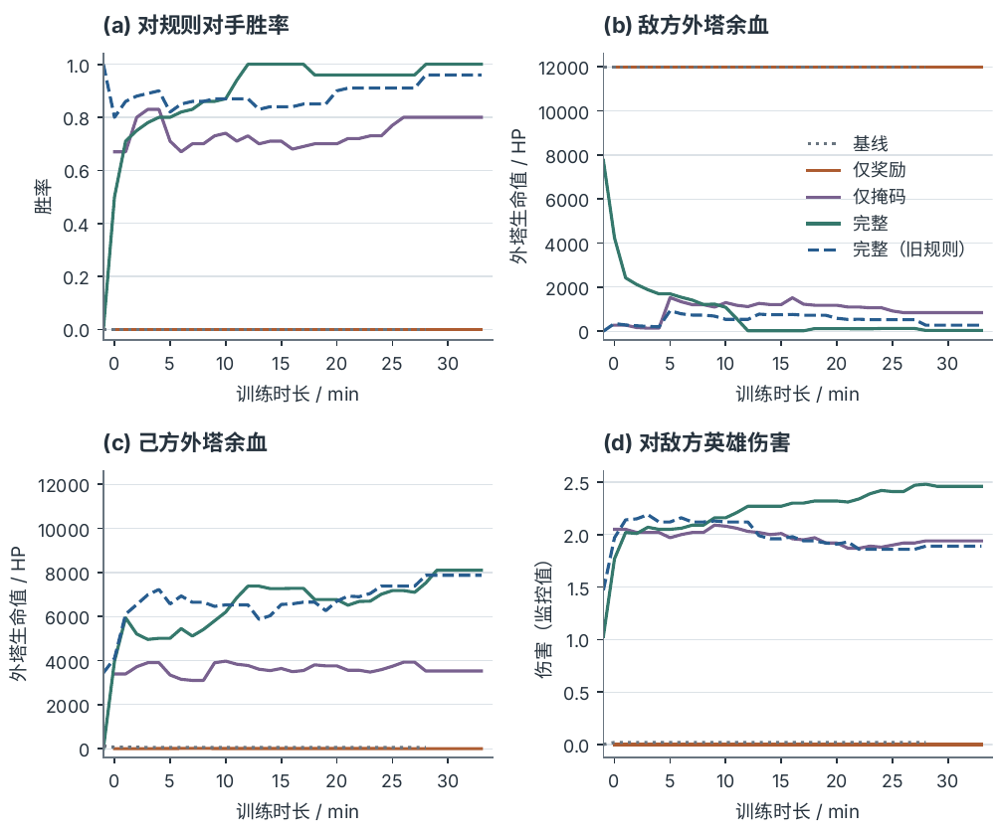

# 王者荣耀 1v1 短时训练中的一致性战术掩码

> Consistent tactical action masking for short-budget reinforcement learning in Honor of Kings 1v1 (Luban No. 7 mirror match, Tencent Kaiwu V63.0.9).

在腾讯开悟平台单次训练只有 25–60 分钟的预算下，平台自带的 PPO 基线学不会推塔。本项目把鲁班七号的战术知识写成**采样前**的合法动作掩码：规则只删除战术上不可取的动作，剩余动作仍由策略采样；同一掩码随样本保存，学习端用它计算新策略概率，再与采样时记录的旧概率求比率，所以 PPO 的新旧策略始终在同一动作支持集上比较。掩码相当于用先验知识缩小策略的假设空间；它只读取智能体本来就能看到的观测，不使用对手或环境的隐藏信息。

这是中国科学技术大学《AI 博弈方法实践》课程期末项目的公开版本，完整技术报告见 [`report/main.pdf`](report/main.pdf)（中文，含英文摘要）。

## 主要结果

同代码、同超参数的 30 分钟冷启动训练，训练终点对内置规则对手 `common_ai` 的监控指标（外塔满值 12000）：

| 配置 | 战术掩码 | 奖励 | 胜率 | 敌方外塔余血 | 己方外塔余血 | 场均 K/D |
|---|---|---|---|---|---|---|
| 平台官方基线（25 min，官方超参数） | 无 | 稀疏 | 0.00 | 12000 | 52 | 0.00 / 0.25 |
| 仅奖励 | 无 | 混合 | 0.00 | 12000 | 4 | 0.00 / 0.00 |
| 仅掩码 | 有 | 稀疏 | 0.80 | 843 | 3526 | 2.53 / 1.73 |
| 完整 | 有 | 混合 | **1.00** | **38** | **8107** | 3.76 / 1.16 |



- 只用稀疏奖励时，胜率在训练开始就有 0.67：推塔能力主要来自掩码。
- 在掩码之上，混合塑形奖励改善了生存与防守；去掉掩码后，同样的奖励没有带来胜局。
- 每组配置只运行了一次，指标来自平台训练监控；局限与后续方向（多种子评测、把硬掩码换成随训练衰减的软先验）见报告第 6 节。

## 仓库内容

| 路径 | 内容 |
|---|---|
| `agent_ppo/feature/tactical_mask.py` | 战术掩码：射程门控、低血撤退与塔下避险、受压选敌、补给滞回、推进走廊、闪现引导、红方方向修正 |
| `tests/test_tactical_mask.py` | 掩码的行为测试 |
| `docs/integration.md` | 接入开悟平台基线需要改动的位置，以及作者在基线文件中新增的代码 |
| `results/` | 云端各训练任务的监控序列与对局日志、离线实验与模型对战汇总 |
| `analysis/report.py` | 由 `results/` 生成报告中的图 |
| `report/` | 技术报告的 LaTeX 源码与编译好的 PDF |

```sh
uv sync                          # numpy、matplotlib、pytest
uv run pytest                    # 掩码测试
uv run python analysis/report.py # 重新生成 report/figures/*.pdf
make -C report                   # 编译报告（XeLaTeX + biber）
```

## 没有包含的内容

- **开悟平台基线框架**（`agent_ppo` 下的智能体、模型、特征处理、训练流程等）。这些文件版权归腾讯所有（All Rights Reserved），其中一部分还是课程练习的待填空模板，因此不在本仓库中。使用平台的同学可以从开悟平台获取基线，再按 [`docs/integration.md`](docs/integration.md) 接入掩码。
- **开悟 GameCore 与公开环境 [`hok_env`](https://github.com/tencent-ailab/hok_env)**：本项目只引用，没有复制其代码。

## 许可

- 代码（`agent_ppo/`、`tests/`、`analysis/`）：[MIT](LICENSE)。
- 报告正文、图与 `results/` 数据：[CC BY 4.0](https://creativecommons.org/licenses/by/4.0/)。
- `report/` 中的排版类文件（`acadreport.cls`、`acadbase.sty`、`acadmath.sty`）来自作者的 LaTeX 模板项目，同为 MIT 许可。
- 封面上的校徽（`report/figures/cover.png`）属于中国科学技术大学，不在上述许可范围内。
- 报告引用的第三方文献与平台文档按各自的许可使用，本仓库不包含其内容。
